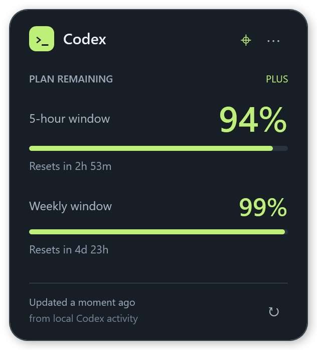

# Codex & Claude Usage Widget for Windows

A small desktop widget that shows the remaining usage in your Codex or Claude plan, including reset times for the current and weekly windows.



The percentages shown in this preview are illustrative. Codex usage comes from the installed Codex executable, with labelled local snapshots as a fallback. Claude usage comes from the latest Claude Code status-line snapshot.

## Features

- Draggable window with an optional always-on-top setting.
- Switch between the full layout and a shorter, two-column compact layout; the selected layout is remembered.
- Remaining usage and reset countdowns for both reported plan windows.
- Select **Codex** or **Claude Code** in Options; the selected provider is remembered.
- Optional automatic continuation of Codex tasks interrupted by a usage limit, with saved **Codex Desktop** or **CLI** target settings.
- Notification-area icon, remembered position, and refresh every 15 seconds.
- Uses existing Codex and Claude Code sign-ins; no API key required.

## Installation

### Download a build

The GitHub Actions workflow builds a portable `win-x64` executable on each push, pull request, or manual workflow run. After a successful run, download `CodexUsageWidget-win-x64` from the workflow's **Artifacts** section and extract it. Run `CodexUsageWidget.exe` on Windows 10 or 11 x64. An installed .NET runtime is not required.

Actions artifacts are build outputs; they are not GitHub Releases.

### Build from source

Clone the repository and run `Launch.cmd`. On first launch, the script runs the usage checks and builds the widget. Building requires the [.NET 10 SDK](https://dotnet.microsoft.com/download/dotnet/10.0) and an internet connection to download Microsoft's runtime packs. The resulting portable executable is written to `dist/CodexUsageWidget.exe`.

After pulling source changes, quit the running widget, run `Build.cmd`, then run `Launch.cmd`.

The build script also supports Windows ARM64:

```powershell
powershell -NoProfile -ExecutionPolicy Bypass -File scripts/Build.ps1 -Runtime win-arm64
```

## Using the widget

- Drag the header to move the widget. Its position is remembered on that device.
- Use the **↕** button in the header to switch between full-size and compact layouts.
- Drag the bottom-right corner to resize the widget. Each layout remembers its own size; compact mode can shrink to 240 × 120 Windows logical pixels. You can also Tab to the resize handle and use the arrow keys.
- At small sizes, auto-resume and always-on-top controls remain available in **⋯ Options**. Hover over the card for usage source and recovery details when the footer is hidden.
- Use the crosshair button to toggle **Always on top**.
- Enable **Auto-resume** in the header to watch for new usage-limit interruptions. Choose **Resume target → Codex Desktop** or **Terminal / CLI** in the options menu.
- Select **⋯** or right-click the widget to refresh, open the Codex usage dashboard, choose a data folder, hide to the notification area, or quit.
- Press **F5** to refresh usage or **Esc** to hide. Double-click the notification-area icon to show the widget again.

## Automatic continuation

Auto-resume is **off by default**. While enabled, the widget watches root chats in the selected Codex data folder for structured usage-limit failures. When Codex confirms that included usage is available, it sends a continuation to the exact interrupted chat. Weekly limits also block recovery; an elapsed countdown alone never starts work. Older Codex versions that do not report `ordinaryUsageAllowed` can display usage but cannot authorize automatic recovery.

**Codex Desktop** requires a running shared app-server with its control socket at `<CODEX_HOME>\app-server-control\app-server-control.sock`, a loaded idle chat, and support for the queue APIs. The widget verifies that a turn actually starts. Installations without this connection show **Desktop connection unavailable**; selecting Desktop never silently runs the chat through the CLI.

**CLI** uses `codex exec resume` with the recorded chat UUID, workspace, model, approval policy, and supported sandbox settings. It does not select the most recent chat or enable permission bypasses. Noninteractive CLI runs cannot answer approval requests; incompatible permissions or providers require manual continuation. CLI recovery currently supports the OpenAI provider with recorded `read-only` or `workspace-write` sandbox policies.

The widget must remain running, including in the notification area. It does not install a scheduled task or service. Disabling auto-resume or changing its target clears pending recovery. Already-dispatched work is not interrupted. A newer user message, cancellation, changed account, or subsequent task activity prevents an old failure from resuming. Spawned agents and failures predating activation are excluded.

Recovery state survives widget restarts. If a crash makes delivery uncertain, the widget requests manual attention instead of sending another continuation. Check the affected chat before disabling and re-enabling recovery.

## Task history in full-size mode

Open **5h tasks ▾** or **Weekly tasks ▾** for local Codex prompts ranked by recorded tokens. Hover for a summary; click for the original prompt, recorded completion, model, token breakdown, tool activity and linked agent subtasks. Prompts stay local; task names are shortened from the prompt without an extra model request.

The lists use the reported reset time and window length. If those are unavailable or expired, they show a labelled rolling five-hour/seven-day lookback. Tasks crossing a boundary include only responses recorded inside that window. Cached input is included in input tokens, and reasoning is included in output tokens; neither is counted twice. Older logs use differences between cumulative counters. A task without token records is shown with an unknown cost.

**Percentage points are estimates**, calculated as a task's token share among local tasks multiplied by reported window usage. Codex does not provide an exact per-task quota charge or fixed subscription token budget. Model weights, caching, other devices/accounts and missing local sessions can make this allocation inaccurate. These are not API prices. Claude status-line snapshots do not contain task history, so these lists are available for Codex only.

## Claude Code setup on Windows

1. Open **⋯ Options → Usage provider → Claude Code**.
2. Select **Set up Claude usage…**. This adds a status-line command to the user-level Claude settings. Use the widget's final location before setup; run setup again if you move the executable.
3. Open Claude Code, sign in with an eligible subscription, and wait for a response. The widget rereads the reported five-hour and weekly allowances every 15 seconds; **F5** rereads immediately.

Claude Code's [documented status-line data](https://code.claude.com/docs/en/statusline) supplies `rate_limits.five_hour` and `rate_limits.seven_day` for supported subscriptions after a response. These are subscription allowances, separate from context tokens or API dollar costs. An API key or gateway spend limit alone does not provide these subscription windows. Update Claude Code if your version does not report them.

The widget labels Claude readings **Claude Code snapshot**. The timestamp is when the bridge received the data, not the time of a fresh account request; idle sessions may keep sending an older allowance. Closed Claude Code sessions cannot update it. A passed reset becomes unknown until Claude reports a new window. Missing windows never imply a full allowance. Claude Desktop alone does not supply this bridge's updates.

Setup honors `CLAUDE_CONFIG_DIR`, defaulting to `%USERPROFILE%\.claude`. It preserves unrelated settings, backs up the original `settings.json` to `settings.json.usage-widget.bak`, and leaves existing custom status lines untouched. Project settings, managed policy, workspace trust, or disabled custom hooks can prevent the user-level bridge from running.

If you already have a custom status line, forward the original JSON to the widget from that script and discard its output. Read stdin once and reuse that input for your existing renderer. For example, in a PowerShell status-line script:

```powershell
$raw = [Console]::In.ReadToEnd()
$raw | & 'C:\path\to\CodexUsageWidget.exe' --claude-statusline | Out-Null
$data = $raw | ConvertFrom-Json
# Keep your existing rendering here, using $data.
```

The bridge stores only allowance percentages, reset times, and a receipt timestamp in `<CLAUDE_CONFIG_DIR>\usage-widget\usage.json`. It does not store session metadata or read Claude credentials. Multiple Claude Code sessions share this local snapshot; the last bridge update wins. To disconnect, remove the widget's `statusLine` entry, or restore your previous status-line value from the backup while keeping later unrelated settings edits.

Claude support is display-only. Selecting Claude pauses Codex recovery and clears its pending queue; returning to Codex reapplies your saved auto-resume preference and watches for new interruptions.

## Usage data and privacy

Live usage requires an installed Codex executable and an existing ChatGPT sign-in. The widget discovers native CLI executables on `PATH`, in the standard Codex Desktop installation, or in an npm installation. Codex handles authentication and account requests through its [app-server protocol](https://learn.chatgpt.com/docs/app-server).

By default, local session records come from `%USERPROFILE%\.codex\sessions`. The widget honors `CODEX_HOME`; **Choose Codex data folder** selects another Codex home for both live reads and session monitoring. Settings and recovery metadata stay in `%LOCALAPPDATA%\CodexUsageWidget`, outside the repository. Recovery stores chat and turn identifiers, workspace and execution settings, and a hashed account identifier; it does not copy chat transcripts or credentials.

The widget does not open `auth.json` or collect authentication tokens. Codex makes the authenticated network requests. With auto-resume enabled, Codex may execute work in the interrupted task's workspace. The dashboard opens in a browser only when selected.

Usage refreshes every 15 seconds. Failed live reads display **Last live reading** or **Local snapshot**, with the error in the tooltip. Cached readings never authorize recovery. After a reported reset passes, the display waits for a new reading instead of assuming the allowance has reset.

The [Codex usage dashboard](https://chatgpt.com/codex/settings/usage) is available for comparison. Codex protocol and session formats may change; unsupported records remain unscheduled. Automatic continuation watches local Desktop/CLI root chats, rather than cloud tasks or chats without local session records.

## Development

Run the local usage checks:

```powershell
dotnet run --project tests/UsageChecks/UsageChecks.csproj --configuration Release
```

These checks use temporary fixtures and a fake Codex process; they do not start model tasks. Add `-- --live-rpc` to also verify a real read-only account usage query against the installed Codex.

Check resizing, provider switching, and Claude snapshot display, and render the minimum layouts on Windows without showing the window or starting account queries or task recovery:

```powershell
dotnet run --project tests/WindowChecks/WindowChecks.csproj --configuration Release
```

Layout screenshots are written to `.build/`.

Build and publish the portable executable:

```powershell
powershell -NoProfile -ExecutionPolicy Bypass -File scripts/Build.ps1
```

The widget shows remaining plan usage; it does not estimate API dollar costs or display token totals. This independent project is not affiliated with OpenAI or Anthropic.
